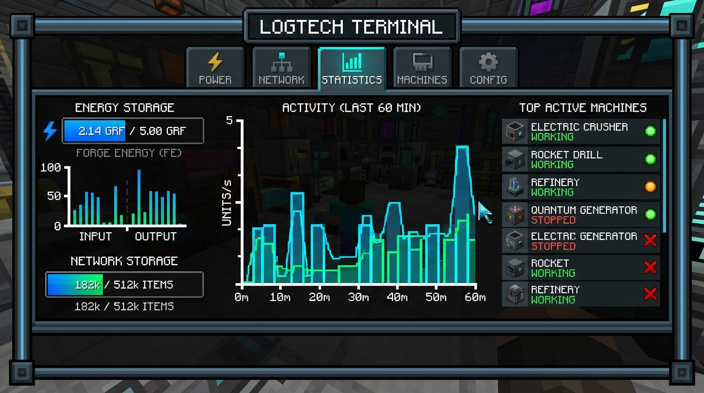

  
  <h1>LogTech</h1>
  
<strong>Fábrica Inteligente, Telemetría y Almacenamiento Digital para Minecraft</strong>

  
<em>Data-driven technology: smart storage, ore prospecting and machine telemetry.</em>

  
  
  
  
  

---

> [!NOTE]
> [Español](#español) | [English](#english)

---

# 🇪🇸 LogTech (Español)

**LogTech** es un mod de tecnología y automatización para Minecraft 1.21.1 basado en NeoForge. Su filosofía central es permitir al jugador **ver, medir y optimizar su fábrica**. Combina un sistema de prospección determinista de vetas minerales, procesamiento con duplicación de polvos, almacenamiento digital escalable y telemetría en tiempo real por máquina.

## 📋 Requisitos
- **Minecraft:** `1.21.1`
- **Mod Loader:** **NeoForge** (versión recomendada `21.0.167` o superior)
- **Java:** `21`
- **Fuente de energía:** Compatible con Forge Energy (FE). *Nota: En esta versión alpha preliminar, LogTech consume energía FE estándar pero no incluye generadores propios; se recomienda emparejar con mods de energía FE o usar cables/bloques compatibles.*

## 💾 Instalación
1. Descarga e instala **Minecraft 1.21.1** con el instalador de **NeoForge**.
2. Descarga el archivo `logtech-0.1.0.jar` desde [Releases en GitHub](https://github.com/Chema280101/LogTech-Mod/releases), [Modrinth](https://modrinth.com) o [CurseForge](https://curseforge.com).
3. Coloca el archivo `.jar` en tu carpeta `.minecraft/mods/`.
4. Inicia el juego.

---

## 🚀 Ruta de Juego (Paso a Paso)

### 1. Prospección y Exploración (El Escáner)
- Craftea el **Escáner** con 4 lingotes de hierro, 1 redstone y 1 brújula.
- **Click derecho:** Realiza un pulso de radar en un radio de 96 bloques en el Overworld. Si localiza vetas minerales subterráneas (Neoferrita o Cristalita), las registra en tu mapa persistente.
- **Shift + Click derecho:** Abre la interfaz del **Mapa de Vetas 2D**.
  - Visualiza en tiempo real tu posición y orientación.
  - Vetas de **Neoferrita** (círculos cian) y **Cristalita** (círculos magenta) con su pureza y reserva estimada.
  - Soporta zoom con la rueda del ratón (0.2x a 4.0x), arrastre (pan) y recentrado con la tecla `Espacio` o `R`.

### 2. Extracción Automatizada (La Perforadora)
- Fabrica la **Perforadora** con lingotes de hierro, redstone y un pico de hierro.
- Colócala en el terreno sobre el área de una veta previamente descubierta con el escáner.
- Aliméntala con energía FE (consume 80 FE/t).
- La perforadora extraerá mineral bruto (`raw_neoferrite` o `raw_crystalite`) directo a su búfer interno cada 40 ticks y lo expulsará automáticamente a inventarios adyacentes o cables Backbone cada 20 ticks.

### 3. Procesamiento y Duplicación (El Triturador)
- Fabrica el **Triturador** con hierro, adoquín y redstone.
- Suministra energía FE (40 FE/t).
- Introduce minerales brutos por la parte superior o lateral: cada mineral bruto se procesará en **2 polvos** (`neoferrite_dust` o `crystalite_dust`), duplicando el rendimiento respecto al horno común.
- Los productos terminados pueden extraerse automáticamente por la cara inferior.

### 4. Metalurgia y Componentes Avanzados
- **Neoferrita:** Funde el polvo en un horno o alto horno para obtener lingotes de Neoferrita.
- **Cristales de datos:** Combina polvo de Cristalita con amatista y redstone en la mesa de crafteo para crear Cristales de Datos, la base para módulos lógicos avanzados.

### 5. Red de Almacenamiento Inteligente y Telemetría
- **Núcleo (Core):** El cerebro de tu red. Requiere 20 FE/t. Gestiona los módulos de almacenamiento y centraliza la telemetría de las máquinas conectadas.
- **Backbone (Cable/Bus):** Conecta tus bloques a la red. Permite la inserción directa de ítems desde tolvas, tuberías u otras máquinas.
- **Rack:** Módulo de servidores para hasta 4 Módulos de datos. Cada módulo almacena 4 096 ítems de base.
- **Terminal:** Interfaz gráfica para acceder al almacenamiento:
  - **Pestaña Ítems:** Búsqueda en tiempo real por texto, ordenamiento por cantidad o nombre, e inserción/extracción fluida.
  - **Pestaña Estadísticas:** Monitor de telemetría en tiempo real:
    - Gráfica de barras de actividad de la red de los últimos 60 minutos.
    - Medidor de energía acumulada y consumo.
    - Barra de capacidad usada/total con alerta de sobrecarga.
    - Top 10 máquinas más activas conectadas a la red con su estado detallado (en funcionamiento, inactiva sin energía, etc.).

### 6. Configuración del Servidor
Puedes personalizar las mecánicas en `saves/<tu_mundo>/serverconfig/logtech-server.toml`:
- Capacidad por módulo de datos (por defecto: 4096).
- Consumos de energía FE por tick del Núcleo, Triturador y Perforadora.
- Velocidad y rendimiento de la perforadora.
- Opción de reservas infinitas (`infiniteReserves = false`).
- Rango y tiempo de recarga del Escáner.

---

## ⚠️ Problemas Conocidos (Alpha v0.1.0)
*Esta es una lista editable de problemas y limitaciones conocidas en la versión alpha:*
- [ ] No incluye generadores de energía propios; requiere mods externos que suministren Forge Energy (FE) o baterías.
- [ ] La reserva mostrada en los tooltips del mapa de vetas es una instantánea al momento de abrir la pantalla; para actualizar los datos tras una larga jornada de perforación, cierra y vuelve a abrir el mapa.
- [ ] Las máquinas (`crusher`, `drill`) actúan como nodos hoja: se conectan a la red a través de Backbones o directamente al Núcleo, pero no conducen la red a otros bloques adyacentes a ellas.
- [ ] Las texturas de bloques e ítems actuales son funcionales y provisionales, sujetas a mejoras visuales en próximas versiones.

## 🐛 Reporte de Errores y Sugerencias
Si encuentras un error o tienes una propuesta:
1. Revisa que no haya un reporte existente en [GitHub Issues](https://github.com/Chema280101/LogTech-Mod/issues).
2. Abre un nuevo issue adjuntando:
   - Versión exacta de Minecraft, NeoForge y LogTech.
   - Lista de mods instalados.
   - Registro de crash o log (`logs/debug.log` o `crash-reports/`).
   - Pasos detallados para reproducir el fallo.

---

# 🇬🇧 LogTech (English)

**LogTech** is a technology and factory automation mod for Minecraft 1.21.1 powered by NeoForge. Its core focus is empowering the player to **monitor, measure, and optimize their production lines**. It features deterministic ore vein prospecting, ore duplication processing, scalable digital item storage, and per-machine telemetry.

## 📋 Requirements
- **Minecraft:** `1.21.1`
- **Mod Loader:** **NeoForge** (version `21.0.167` or newer recommended)
- **Java:** `21`
- **Power Source:** Any Forge Energy (FE) compatible generator or storage mod. *Note: In alpha v0.1.0, LogTech machines consume standard FE but do not include indigenous generators yet.*

## 💾 Installation
1. Install **Minecraft 1.21.1** with the **NeoForge** installer.
2. Download `logtech-0.1.0.jar` from [GitHub Releases](https://github.com/Chema280101/LogTech-Mod/releases), [Modrinth](https://modrinth.com), or [CurseForge](https://curseforge.com).
3. Place the `.jar` into your `.minecraft/mods/` directory.
4. Launch Minecraft.

---

## 🚀 Progression Walkthrough

### 1. Prospecting & Exploration (The Scanner)
- Craft the **Scanner** with 4 iron ingots, 1 redstone dust, and 1 compass.
- **Right-Click:** Scans for underground ore deposits in a 96-block radius across the Overworld.
- **Shift + Right-Click:** Opens the interactive **2D Vein Map**.
  - Shows player location and facing angle.
  - Displays discovered **Neoferrite** (cyan) and **Crystalite** (magenta) circular deposits with purity and estimated reserves.
  - Supports scroll-wheel zoom (0.2x to 4.0x), mouse drag (pan), and recentering with `Space` or `R`.

### 2. Automated Extraction (The Drill)
- Craft the **Drill** using iron ingots, redstone, and an iron pickaxe.
- Place it on the surface within the bounds of a vein you discovered using the scanner.
- Provide FE power (80 FE/t).
- The drill extracts raw ore (`raw_neoferrite` or `raw_crystalite`) every 40 ticks into its internal buffer and automatically ejects into adjacent inventories or Backbone cables every 20 ticks.

### 3. Ore Duplication (The Crusher)
- Craft the **Crusher** with cobblestone, iron, and redstone.
- Connect FE power (40 FE/t).
- Insert raw ores via top/sides: each raw ore is processed into **2 dusts** (`neoferrite_dust` or `crystalite_dust`), doubling yield over standard smelting.
- Output items can be extracted from the bottom face.

### 4. Metallurgy & Advanced Crafting
- **Neoferrite:** Smelt dust in a furnace or blast furnace into Neoferrite Ingots.
- **Data Crystals:** Combine Crystalite dust with amethyst and redstone to produce Data Crystals, essential for data storage media.

### 5. Smart Storage Network & Telemetry
- **Core:** Central controller of your network. Consumes 20 FE/t. Handles virtual inventory and tracks connected machine telemetry.
- **Backbone (Cable/Bus):** Connects machines and components. Supports automated external insertion via hoppers, pipes, or machine outputs.
- **Rack:** Holds up to 4 Data Modules. Each module holds 4,096 items by default.
- **Terminal:** Interactive station to manage your logistics:
  - **Items Tab:** Text search bar, sort toggle (by count or name), and instant shift-click extraction/insertion.
  - **Statistics Tab:** Real-time factory telemetry:
    - 60-minute network activity bar chart.
    - Energy storage level and consumption rate.
    - Network storage gauge with overload indicators.
    - Top 10 active machines list showing real-time operational status (working, idle, no energy, etc.).

### 6. Server Configuration
Customize gameplay parameters in `saves/<world>/serverconfig/logtech-server.toml`:
- Storage capacity per Data Module (default: 4096).
- FE energy consumption rates for Core, Crusher, and Drill.
- Drill cycle delay and output count.
- Infinite reserves toggle (`infiniteReserves = false`).
- Scanner search radius and cooldown ticks.

---

## ⚠️ Known Issues (Alpha v0.1.0)
*Editable list of known bugs and limitations:*
- [ ] No built-in energy generators; requires companion tech mods supplying Forge Energy (FE).
- [ ] Vein map reserves reflect a snapshot at the moment the GUI opens; close and reopen to refresh after heavy mining.
- [ ] Machine blocks (`crusher`, `drill`) act as network endpoints (leaf nodes): they connect to cables but do not pass network signals to adjacent blocks.
- [ ] Block and item textures are functional placeholders and will receive visual improvements in subsequent releases.

## 🐛 Bug Reports & Feedback
Found an issue or want to suggest a feature?
1. Check the existing list on [GitHub Issues](https://github.com/Chema280101/LogTech-Mod/issues).
2. Open a new issue with:
   - Minecraft, NeoForge, and LogTech version numbers.
   - Full mod list.
   - Crash log or `logs/debug.log`.
   - Clear reproduction steps.

---

## 📜 License
LogTech is released under the **[MIT License](LICENSE)**. You are welcome to include it in modpacks and share your feedback!
