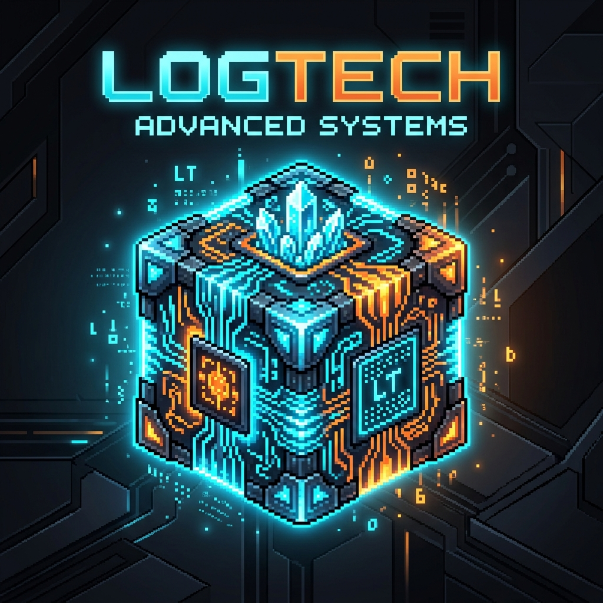
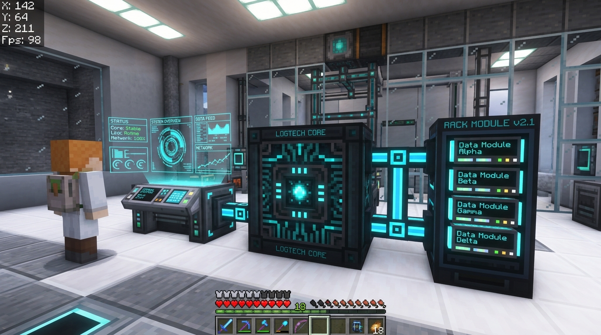
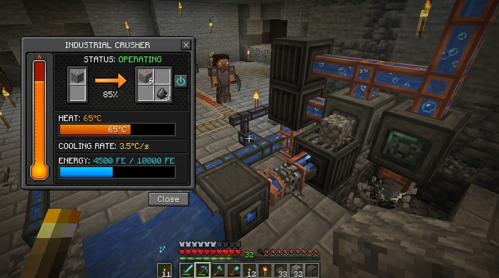
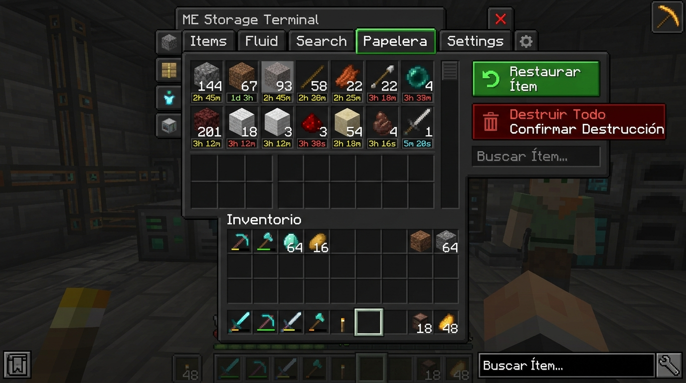
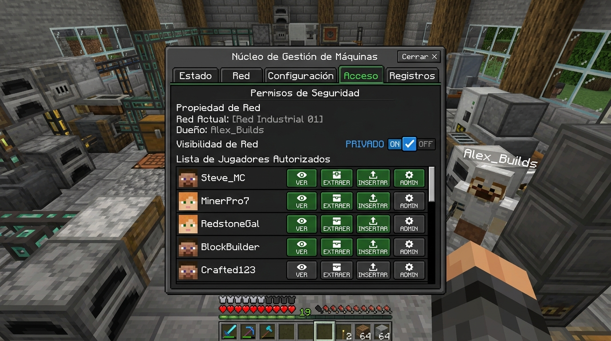
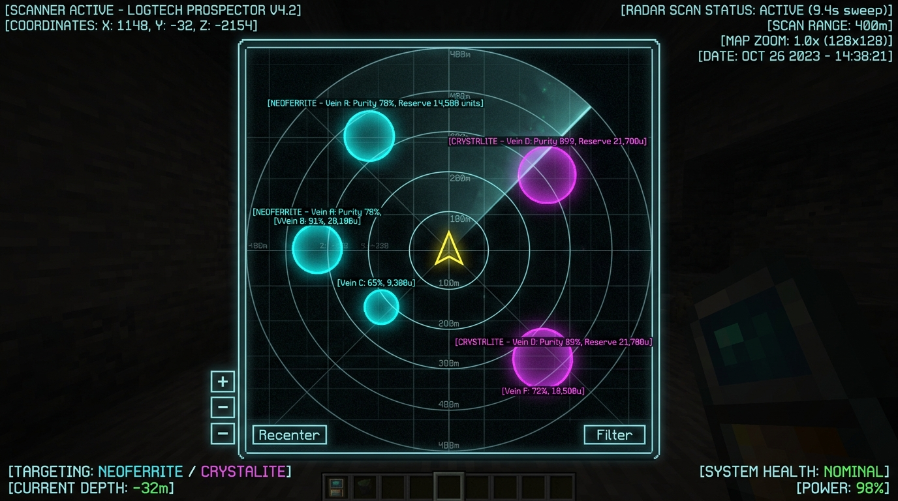
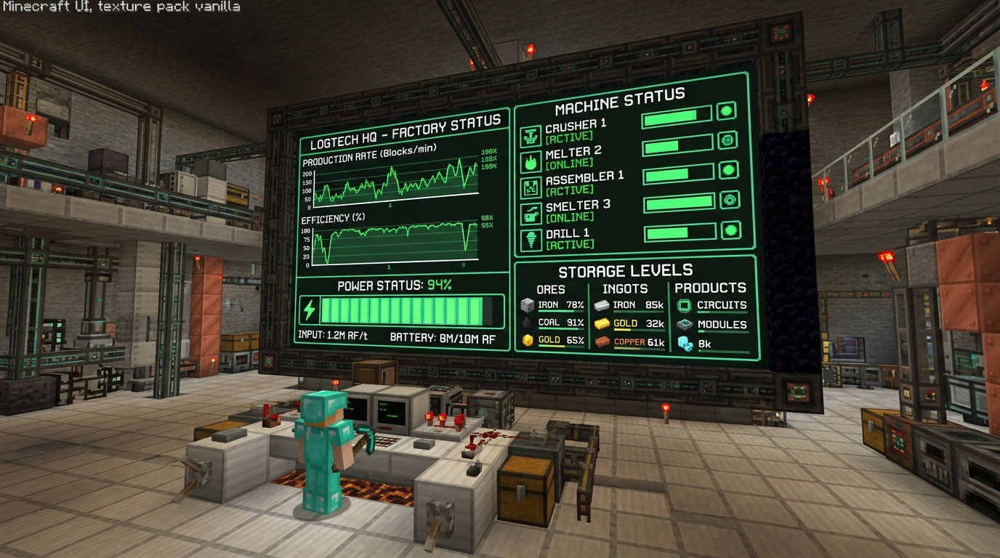

  
  <h1>LogTech</h1>
  
<strong>Fábrica Inteligente, Telemetría y Almacenamiento Digital para Minecraft</strong>

  
<em>Data-driven technology: smart storage, ore prospecting and machine telemetry.</em>

  
  
  
  
  
  

---

> [!WARNING]
> ### ⚠️ NOTA DE MIGRACIÓN CRÍTICA / CRITICAL MIGRATION NOTICE
> **🇪🇸 Antes de actualizar desde la v0.1 o la v0.2:**
> 1. **Haz una copia de seguridad obligatoria de tu mundo** antes de instalar la versión v0.3.0.
> 2. **Compatibilidad unidireccional:** Un mundo cargado o guardado con la versión v0.3 **NO se puede volver a abrir con la v0.1 ni con la v0.2** (provocaría corrupción o pérdida de datos debido a las nuevas estructuras de NBT y `data_version: 8`).
> 3. **Conservación íntegra de datos:** Todos los datos existentes de mundos v0.1 y v0.2 (redes, inventarios, niveles caliente/frío, energía y reglas) se migran automáticamente al 100% sin pérdida de ítems ni configuraciones.
> 4. **Seguridad de redes y protección perimetral:** En modo Privado, las redes controlan estrictamente quién puede abrir el Terminal, insertar o extraer ítems, modificar reglas y romper el bloque del Núcleo (restringido a Administradores). **Ten en cuenta que los bloques periféricos (cables Backbone, Racks, Terminales) no están protegidos individualmente contra rotura física en el mundo;** para una protección perimetral completa en servidores multijugador se recomienda combinarlo con mods de reclamo de chunks (como FTB Chunks, FLAN o Open Parties and Claims).
>
> **🇬🇧 Before upgrading from v0.1 or v0.2:**
> 1. **Make a mandatory backup of your world** before installing v0.3.0.
> 2. **One-way compatibility:** A world opened or saved in v0.3 **CANNOT be reopened in v0.1 or v0.2** (opening with older versions will cause data loss or corruption due to upgraded NBT schemas and `data_version: 8`).
> 3. **Full data preservation:** All existing inventories, hot/cold tiers, energy buffers, and automation rules from v0.1 and v0.2 are automatically migrated 100% with zero item loss.
> 4. **Network security & perimeter boundaries:** In Private mode, networks strictly regulate who can access the Terminal, insert/extract items, edit rules, and break the Core block (restricted to Admins). **Please note that peripheral blocks (Backbone cables, Racks, Terminals) are not individually protected against physical breaking in the world;** pairing with chunk claim mods (such as FTB Chunks, FLAN, or Open Parties and Claims) is recommended for full perimeter security on multiplayer servers.

---

> [!NOTE]
> [Español](#español) | [English](#english)

---

# 🇪🇸 LogTech (Español)

**LogTech** es un mod de tecnología y automatización para Minecraft 1.21.1 basado en NeoForge. Su filosofía central es permitir al jugador **ver, medir y optimizar su fábrica**. Combina prospección determinista de vetas minerales, procesamiento con cadena de pureza, almacenamiento jerárquico caliente/frío, dinámica térmica con disipadores, chips de firmware, automatización por reglas avanzadas, control de acceso multijugador y telemetría por máquina en tiempo real.

## ✨ Novedades de la Versión v0.3.0 (Alpha)

- **🔥 Sistema Térmico y Disipación Activa:**
  - **Dinámica de Calor (0 a 100 °C):** El Triturador, la Lavadora, la Centrífuga y la Perforadora acumulan temperatura al operar. En condiciones estándar se equilibran a ~50 °C sin problemas.
  - **Ralentización y Apagado:** Por encima de 70 °C la máquina entra en estrangulamiento térmico (opera al 50% de velocidad consumiendo la mitad de FE). A 100 °C se apaga por seguridad (`OVERHEATED`) y no se reactiva hasta enfriar a $\le 40$ °C.
  - **Bloque Disipador (`heatsink`):** Añade refrigeración pasiva continua (+1.0 °C/s por disipador en contacto) y refrigeración líquida (+0.5 °C/s por cara sumergida en agua).
  - Medidor de calor con barra animada, tooltips informativos en pantalla y soporte en HUD de Jade.

- **💾 Chips de Firmware para Máquinas:**
  - Ranura dedicada de firmware en Triturador, Lavadora, Centrífuga y Perforadora (con nueva interfaz gráfica propia).
  - **Firmware Eco:** Velocidad ×0.7, energía ×0.5, calor ×0.5.
  - **Firmware Turbo:** Velocidad ×1.5, energía ×2.0, calor ×3.0 (¡requiere disipadores!).
  - **Firmware Seguro:** Velocidad fija 1.0x sin ralentización intermedia; se apaga preventivamente a 85 °C y reanuda a $\le 30$ °C.
  - **Firmware Selectivo:** Filtro inteligente para tolvas y tuberías automáticas en Lavadora y Centrífuga (configurado con Shift + Clic derecho).

- **🗑️ Red de Seguridad: Papelera y Cuarentena:**
  - **Papelera (`TrashBin`):** Pestaña «Papelera» en el Terminal para recuperar ítems descartados con el botón «Destruir» o reglas de excedente. Capacidad de hasta 4 096 ítems y 30 minutos de vida (`gameTime`) con expiración FIFO y restauración con un clic.
  - **Cuarentena (`QuarantineBuffer`):** Búfer de emergencia de 1 024 ítems en el Núcleo que absorbe entradas automáticas cuando la red se queda sin energía o espacio, vaciándose automáticamente a la red al restablecerse.
  - **Acción «Descartar excedente» (`DISCARD_EXCESS`):** Regla que mantiene el inventario exactamente en $N$, enviando los sobrantes a la papelera sin oscilaciones.
  - **Condición «Cuarentena mayor que» (`QUARANTINE_GREATER`):** Detecta acumulaciones en cuarentena para alertar al jugador o encender alarmas.

- **📦 Compactación Automática de Recursos (`COMPACT`):**
  - Acción en reglas del Núcleo que analiza automáticamente el libro de recetas en busca de relaciones 3×3 o 2×2 simétricas reversibles (lingotes $\leftrightarrow$ bloques).
  - Convierte atómicamente excedentes respetando componentes especiales y pureza mineral, con lista negra configurable.

- **🔍 Vistas Guardadas y Filtros Avanzados:**
  - 8 botones de acceso directo [1..8] en el Terminal. Guarda con Shift + Clic y recupera con un Clic tus filtros de texto, criterio de ordenación, nivel (`Todos`, `Caliente`, `Frío`) y pureza mínima (0 a 5).
  - Sincronización en tiempo real entre todos los jugadores que tengan el Terminal abierto.

- **📈 Estimaciones de Flujo y Tendencias:**
  - Rastreador en memoria (`RateTracker`) de 5 minutos: los tooltips de ítems muestran su ritmo neto (`+120/min`, `−45/min`) y el tiempo estimado hasta agotarse.
  - La pestaña Estadísticas pronostica el tiempo de llenado total y segregado por nivel caliente y frío.

- **🔑 Llave de Configuración (`config_key`):**
  - Herramienta para clonar configuraciones en masa: Shift + Clic derecho copia los ajustes (prioridad eléctrica en máquinas, canales en alarmas, reglas y fijación en el Núcleo) y Clic derecho los aplica en bloques idénticos.

- **🛡️ Permisos de Acceso y Redes Privadas:**
  - El jugador que coloca el Núcleo se registra como Propietario.
  - Conmutador entre red **Abierta** (acceso público) y **Privada** (controlada).
  - Pestaña **Acceso** en el Núcleo para gestionar usuarios con permisos granulares: Ver (`VIEW`), Extraer (`EXTRACT`), Insertar (`INSERT`) y Administrar (`ADMIN`).
  - Revocación instantánea en tiempo real (cierra interfaces al retirar permisos) y protección contra rotura del Núcleo para jugadores no administradores.

- **📜 Registro de Auditoría de Actividad:**
  - Búfer de 500 eventos en el Núcleo que registra inserciones, extracciones, destrucciones, restauraciones y cambios de reglas o permisos ejecutados por jugadores.
  - Agrupación temporal inteligente (10 s) para evitar saturación ante clics repetidos.
  - Pestaña **Registro** en el Terminal para administradores con navegación paginada y buscador por nombre de jugador.

---

## 📋 Requisitos
- **Minecraft:** `1.21.1`
- **Mod Loader:** **NeoForge** (versión recomendada `21.0.167` o superior)
- **Java:** `21`
- **Opcionales recomendados:** Jade (`15.10.6+`), JEI (`19.21.0+`) o EMI.

## 💾 Instalación
1. Instala **Minecraft 1.21.1** con el instalador oficial de **NeoForge**.
2. Descarga `logtech-0.3.0.jar` desde [Releases en GitHub](https://github.com/Chema280101/LogTech-Mod/releases), [Modrinth](https://modrinth.com) o [CurseForge](https://curseforge.com).
3. Coloca el archivo `.jar` en tu carpeta `.minecraft/mods/`.
4. *(Opcional)* Añade Jade o JEI a la carpeta `mods/` para disfrutar de integración HUD y recetario en juego.
5. Inicia el juego.

---

## 🚀 Ruta de Juego y Guía de Fábrica

### 1. Prospección Subterránea (El Escáner)
- Craftea el **Escáner** (hierro, redstone y brújula).
- **Clic derecho:** Explora un radio de 96 bloques. Descubre vetas subterráneas de **Neoferrita** o **Cristalita** e identifica su **pureza determinista (1 a 5)** y reservas estimadas.
- **Shift + Clic derecho:** Abre el **Mapa de Vetas 2D** interactivo con orientación y marcadores.

### 2. Extracción Automatizada (La Perforadora)
- Fabrica la **Perforadora** y colócala en la superficie sobre el área de una veta descubierta.
- Aliméntala con 80 FE/t (o conéctala a un Backbone energizado).
- Abre su interfaz para instalar chips de firmware (como Turbo o Eco) y revisar su almacenamiento interno.
- La perforadora extraerá mineral bruto conservando la **pureza de la veta** y expulsándolo a tolvas, tuberías o cables Backbone.
- Cambia su prioridad eléctrica con **Shift + Clic derecho** sobre el bloque.

### 3. Procesamiento y Cadena de Pureza
- **Triturador (40 FE/t):** Convierte 1 mineral en 2 polvos conservando su pureza.
- **Lavadora (60 FE/t, 250 mB agua):** Sube la pureza del polvo en +1 y genera lodo (`sludge`). Con un chip de firmware **Selectivo**, puedes ordenar a las tolvas inferiores que solo extraigan el lodo.
- **Centrífuga (80 FE/t):** Extrae escoria (`slag`) según la pureza inversa y procesa el lodo para obtener fragmentos de cristal (`crystal_shard`).

### 4. Refrigeración y Gestión Térmica
- Las máquinas bajo carga continua acumulan calor. Si usas chips **Turbo** (1.5x velocidad), la generación de calor se triplica.
- Coloca bloques **Disipadores (`heatsink`)** adyacentes a las caras de la máquina o haz fluir **agua** por sus lados para mantenerlas por debajo de 70 °C y evitar el estrangulamiento térmico.

### 5. Almacenamiento Inteligente, Papelera y Seguridad
- Conecta el **Núcleo**, **Racks Calientes**, **Racks Fríos** y **Terminales**.
- Equipa módulos avanzados (4x) y maestros (16x).
- Si eliminas ítems por error, abre la pestaña **Papelera** en el Terminal para restaurarlos.
- Configura reglas de automatización en el Núcleo:
  - `Compactar`: convierte lingotes sobrantes en bloques de forma automática.
  - `Descartar excedente`: elimina excesos hacia la papelera.
  - `Alarma`: dispara señales de redstone de 4 canales.
- En servidores multijugador, abre la pestaña **Acceso** en el Núcleo, cambia la red a modo **Privado** y autoriza a tus compañeros con permisos personalizados.
- Usa la **Llave de Configuración (`config_key`)** con Shift + Clic derecho para copiar tus reglas y duplicarlas en otros núcleos o máquinas.

---

## ⚙️ Configuración del Servidor
Puedes personalizar todos los parámetros de balance en `saves/<tu_mundo>/serverconfig/logtech-server.toml`:
- Capacidades de módulos básicos, avanzados y maestros.
- Racks fríos, búfer del Núcleo y reparto de energía.
- Dinámica térmica: tasas de generación base, enfriamiento pasivo, disipadores y umbrales de seguridad.
- Modificadores de chips de firmware (Eco, Turbo, Seguro).
- Capacidades y tiempos de retención de Papelera y Cuarentena.
- Límites de compactación por ciclo y lista negra de recetas.
- Filtros, seguridad, registro de auditoría y ventana de agrupación temporal.

---

## ⚠️ Problemas Conocidos y Notas de Compatibilidad
- [x] Generación de energía nativa: incluye Generador de Carbón (`coal_generator`) para operar redes independientes.
- [ ] La reserva mostrada en los tooltips del mapa de vetas refleja una instantánea al momento de abrir la pantalla.
- [ ] Las máquinas actúan como nodos hoja en la red (se conectan a Backbones pero no enrutan señales a bloques adyacentes por diseño).
- **Protección Perimetral en Redes Privadas:** El modo Privado bloquea la rotura del Núcleo y restringe el acceso al Terminal, inserciones, extracciones y reglas. Los cables Backbone, Racks y Terminales no cuentan con protección contra rotura física individual; para servidores públicos se aconseja utilizar mods de reclamo de terreno.

---

# 🇬🇧 LogTech (English)

**LogTech** is a factory automation and logistics technology mod for Minecraft 1.21.1 powered by NeoForge. Its core philosophy is empowering players to **monitor, measure, and optimize their production lines**. Featuring deterministic ore vein prospecting, purity refining pipelines, dual-tier hot/cold storage, thermal dissipation mechanics, machine firmware chips, advanced automation rules, multiplayer access control, and 60-minute per-machine telemetry.

## ✨ What's New in v0.3.0 (Alpha Release)

- **🔥 Thermal System & Active Dissipation:**
  - **Heat Dynamics (0 to 100 °C):** Crusher, Washer, Centrifuge, and Mining Drill generate heat while operating. Under standard workloads they stabilize at ~50 °C.
  - **Throttling & Shutdown:** Above 70 °C, machines enter thermal throttling (operating at 0.5x speed with 0.5x power draw). At 100 °C, they shut down safely (`OVERHEATED`) and will not resume until cooling to $\le 40$ °C.
  - **Heatsink Block (`heatsink`):** Provides passive heat dissipation (+1.0 °C/s per adjacent block) and water immersion cooling (+0.5 °C/s per water face).
  - Real-time heat gauge bar, cooling rate tooltips, and Jade HUD compatibility.

- **💾 Machine Firmware Chips:**
  - Dedicated firmware slot in Crusher, Washer, Centrifuge, and Mining Drill (which now features a dedicated GUI).
  - **Eco Firmware:** 0.7x speed, 0.5x energy, 0.5x heat.
  - **Turbo Firmware:** 1.5x speed, 2.0x energy, 3.0x heat (cooling heatsinks recommended!).
  - **Safe Firmware:** Locked 1.0x speed without intermediate throttling; triggers early shutdown at 85 °C and resumes at $\le 30$ °C.
  - **Selective Firmware:** Intelligent extraction filter for automated hoppers and fluid/item pipes in Washers and Centrifuges.

- **🗑️ Storage Safety Net: Trash Bin & Quarantine:**
  - **Trash Bin (`TrashBin`):** Dedicated "Papelera" tab in the Terminal to recover discarded items from the "Destruir" button or excess rules. Holds up to 4,096 items for 30 minutes (`gameTime`) with FIFO expiration and one-click restoration.
  - **Quarantine Buffer (`QuarantineBuffer`):** 1,024-item emergency buffer in the Core that catches automated inputs when the network is full, unpowered, or overloaded, draining automatically back into the network once restored.
  - **"Discard Excess" Rule Action (`DISCARD_EXCESS`):** Keeps inventory at exactly $N$, redirecting excess stock to the trash bin cleanly without oscillation.
  - **"Quarantine Greater" Rule Condition (`QUARANTINE_GREATER`):** Monitors quarantine buffer levels to sound alarms or trigger automation.

- **📦 Automated Resource Compaction (`COMPACT`):**
  - Core automation rule action that scans dynamic recipes for reversible 3×3 or 2×2 symmetries (e.g. ingots $\leftrightarrow$ blocks).
  - Atomically compacts excess items while preserving custom data components, mineral purity, and respecting configurable blacklists.

- **🔍 Saved Views & Advanced Filters:**
  - 8 quick-access slots [1..8] above the Terminal tabs. Save with Shift + Click and restore with a regular Click your search query, sort mode, storage tier filter (`All`, `Hot`, `Cold`), and minimum purity (0 to 5).
  - Real-time bidirectional synchronization across all players using the Terminal.

- **📈 Rate Tracking & Inventory Forecasts:**
  - In-memory `RateTracker` tracking 5-minute rolling averages: item tooltips display net trends (`+120/min`, `−45/min`) and depletion countdowns.
  - The Stats tab displays forecasted fill times for total network storage as well as hot and cold tiers.

- **🔑 Configuration Key (`config_key`):**
  - Tool to duplicate settings effortlessly: Shift + Right Click copies configuration (machine power priorities, alarm channels, Core rules and tier pinning) and Right Click pastes onto compatible blocks.

- **🛡️ Access Permissions & Private Networks:**
  - Core placer is registered as Network Owner.
  - Toggle between **Open** (public access) and **Private** (restricted) security modes.
  - **Access** tab in Core GUI to manage authorized players with granular permissions: View (`VIEW`), Extract (`EXTRACT`), Insert (`INSERT`), and Administer (`ADMIN`).
  - Real-time instant revocation (closes open menus immediately) and Core breaking protection for non-admin players.

- **📜 Activity Audit Log:**
  - 500-entry circular buffer tracking manual player actions (insertions, extractions, destructions, restorations, rule/access changes).
  - 10-second temporal grouping preventing spam from repeated shift-clicks.
  - Dedicated **Registro** (Log) tab in the Terminal for administrators with paginated browsing and player name search.

---

## 📋 Requirements
- **Minecraft:** `1.21.1`
- **Mod Loader:** **NeoForge** (version `21.0.167` or higher)
- **Java:** `21`
- **Optional Companion Mods:** Jade (`15.10.6+`), JEI (`19.21.0+`), or EMI.

## 💾 Installation
1. Install **Minecraft 1.21.1** with **NeoForge**.
2. Download `logtech-0.3.0.jar` from [GitHub Releases](https://github.com/Chema280101/LogTech-Mod/releases), [Modrinth](https://modrinth.com), or [CurseForge](https://curseforge.com).
3. Place the `.jar` inside your `.minecraft/mods/` directory.
4. *(Optional)* Add Jade or JEI to the `mods/` folder for in-game HUD and recipe viewing.
5. Launch Minecraft.

---

## 🚀 Progression Walkthrough & Factory Guide

### 1. Underground Prospecting (The Scanner)
- Craft the **Scanner** (iron, redstone, compass).
- **Right-Click:** Scans a 96-block radius for **Neoferrite** or **Crystalite** veins, identifying their deterministic **purity (1 to 5)** and estimated reserves.
- **Shift + Right-Click:** Opens the interactive **2D Vein Map** with zoom, pan, and deposit markers.

### 2. Automated Mining (The Drill)
- Place the **Mining Drill** on the surface within the bounds of a discovered deposit.
- Provide FE power (80 FE/t) or connect to an energized Backbone.
- Open its GUI to install firmware chips (such as Turbo or Eco) and inspect internal storage.
- The drill extracts raw ores carrying the **exact purity of the underlying deposit** and ejects into adjacent containers.
- Cycle machine power priority (`High`, `Normal`, `Low`) with **Shift + Right-Click** on the Drill block.

### 3. Refining Pipeline & Purity Upgrades
- **Crusher (40 FE/t):** Converts 1 raw ore into 2 dusts while preserving mineral purity.
- **Washer (60 FE/t, 250 mB water):** Increases dust purity by +1 and outputs sludge (`sludge`). With a **Selective** firmware chip, you can configure bottom hoppers to extract only the sludge.
- **Centrifuge (80 FE/t):** Separates slag (`slag`) inversely proportional to purity and processes sludge into valuable crystal shards (`crystal_shard`).

### 4. Thermal Management & Dissipation
- Machines operating continuously accumulate heat. Using **Turbo** chips increases speed by 50% but triples heat generation.
- Place **Heatsink blocks (`heatsink`)** on adjacent faces or submerge sides in **water** to maintain operation below 70 °C and prevent thermal throttling.

### 5. Smart Storage, Trash Safety & Access Security
- Connect the **Core**, **Backbone** cables, **Hot Racks**, and **Cold Racks**.
- Upgrade with Advanced (4x) and Master (16x) Data Modules.
- In case of accidental deletion, open the Terminal's **Trash** tab to restore items.
- Configure Core automation rules:
  - `Compact`: automatically transforms excess ingots into storage blocks.
  - `Discard Excess`: manages overflow safely into the trash bin.
  - `Alarm`: triggers 4-channel redstone alarms.
- On multiplayer servers, switch the Core to **Private** mode and assign custom roles to teammates in the **Access** tab.
- Use the **Configuration Key (`config_key`)** with Shift + Right Click to copy your configuration and paste it onto identical machines across your factory.

---

## ⚙️ Server Configuration
Customize all balance parameters in `saves/<world>/serverconfig/logtech-server.toml`:
- Module capacities and cold rack multipliers.
- Thermal dynamics: base generation, passive dissipation, heatsinks, and overheat thresholds.
- Firmware chip modifiers (Eco, Turbo, Safe).
- Trash bin and quarantine capacities and retention lifetimes.
- Compaction limits per cycle and recipe blacklists.
- Rate tracking limits, security permissions, and audit log buffer parameters.

---

## ⚠️ Known Issues & Security Note
- [x] Native power generation: includes Coal Generator (`coal_generator`) for standalone networks.
- [ ] Deposit reserves in vein map tooltips reflect a snapshot at the time the UI is opened.
- [ ] Machines act as leaf network nodes (connect to Backbones but do not relay signals to adjacent blocks by design).
- **Perimeter Security on Private Networks:** Private mode protects the Core against unauthorized breaking and restricts Terminal access, item transfers, and rules. Peripheral cables, racks, and terminals are not individually protected against breaking in the world; pairing with land claim mods is recommended for public servers.

---

## 📜 License
LogTech is released under the **[MIT License](LICENSE)**. All textures, models, and assets created for the mod are free and open source under the MIT License. You are welcome to include LogTech in modpacks and share your feedback!
