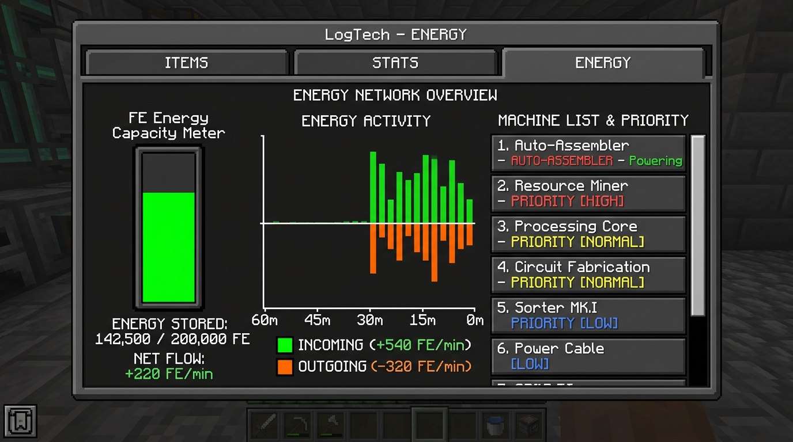

  
  <h1>LogTech</h1>
  
<strong>Fábrica Inteligente, Telemetría y Almacenamiento Digital para Minecraft</strong>

  
<em>Data-driven technology: smart storage, ore prospecting and machine telemetry.</em>

  
  
  
  
  
  

---

> [!WARNING]
> ### ⚠️ NOTA DE MIGRACIÓN CRÍTICA / CRITICAL MIGRATION NOTICE
> **🇪🇸 Antes de actualizar desde la v0.1:**
> 1. **Haz una copia de seguridad obligatoria de tu mundo** antes de instalar la versión v0.2.0.
> 2. **Compatibilidad unidireccional:** Un mundo cargado o guardado con la versión v0.2 **NO se puede volver a abrir con la v0.1** (provocaría corrupción o pérdida de datos debido a las nuevas estructuras de NBT y `data_version`).
> 3. **Conservación de inventario:** Todos los datos existentes en redes y núcleos de la v0.1 se migran automáticamente al 100% hacia el nivel caliente (`rack`) sin pérdida de ítems ni configuraciones.
>
> **🇬🇧 Before upgrading from v0.1:**
> 1. **Make a mandatory backup of your world** before installing v0.2.0.
> 2. **One-way compatibility:** A world opened or saved in v0.2 **CANNOT be reopened in v0.1** (opening with older versions will cause data loss or corruption due to upgraded NBT schemas and `data_version`).
> 3. **Data preservation:** All existing inventories and network blocks from v0.1 are automatically migrated 100% into the Hot storage tier (`rack`) with zero item loss.

---

> [!NOTE]
> [Español](#español) | [English](#english)

---

# 🇪🇸 LogTech (Español)

**LogTech** es un mod de tecnología y automatización para Minecraft 1.21.1 basado en NeoForge. Su filosofía central es permitir al jugador **ver, medir y optimizar su fábrica**. Combina prospección determinista de vetas minerales, procesamiento con cadena de pureza, almacenamiento jerárquico caliente/frío, automatización por reglas en el Núcleo, red eléctrica unificada con prioridades y telemetría por máquina en tiempo real.

## ✨ Novedades de la Versión v0.2.0 (Alpha)

- **💎 Sistema de Pureza Mineral (1 a 5):** Los minerales brutos generados por la Perforadora ahora heredan la pureza determinista de la veta subterránea (1 a 5). Esta pureza se preserva a través del Triturador y de la red de almacenamiento en pilas independientes.
- **🌊 Lavadora Industrial:** Máquina con tanque interno de 4 000 mB de agua. Consume 250 mB de agua y 60 FE/t para purificar el polvo ($p \to p+1$, hasta nivel 5), generando lodo (`sludge`) como subproducto. Compatible con cubos y tuberías de fluidos externas.
- **🔄 Centrífuga de Subproductos:** Procesa polvos a 80 FE/t, separando escoria (`slag`) con una probabilidad que escala inversamente a la pureza del mineral ($80\% \times (6-p)/5$). Además, centrifuga el lodo para extraer valiosos fragmentos de cristal (`crystal_shard`). Cuenta con prevención de pérdida por ranuras llenas (`OUTPUT_FULL`).
- **🔥 Generador de Carbón:** Quema combustibles sólidos convencionales (carbón o carbón vegetal) generando 40 FE/t constantes, permitiendo alimentar redes y maquinaria de LogTech sin requerir mods de energía externos.
- **🧊 Almacenamiento Jerárquico Caliente y Frío:**
  - **Rack Frío (`cold_rack`):** Proporciona **4x capacidad** de almacenamiento respecto al rack estándar (16 384 ítems base por módulo).
  - **Recuperación con Progreso:** La extracción desde el nivel frío en el Terminal incluye una cola visual con cuenta atrás y entrega atómica sin riesgo de duplicación.
  - **Rebalanceo Automático y Fijación:** El Núcleo monitoriza la frecuencia de extracción (+1 uso) con decaimiento temporal y desciende ítems poco usados al frío si el caliente supera el 90%. Puedes fijar cualquier ítem en el Terminal con `Ctrl + Clic derecho` (`AUTO`, `FIJAR_CALIENTE`, `SOLO_FRIO`).
  - **Módulos de Datos Avanzados:** Módulo Avanzado (Nivel 2, 4x capacidad) y Módulo Maestro (Nivel 3, 16x capacidad).
- **⚙️ Reglas de Automatización y Alarma de Redstone:**
  - El Núcleo incorpora una pantalla con pestaña de **Reglas** (hasta 8 reglas configurables) con ranuras fantasma, condiciones por cantidad o espacio usado, histéresis anti-parpadeo y acciones automáticas (`Mover al frío`, `Avisar`, `Señal de redstone`).
  - **Alarma (`alarm`):** Bloque de red con 4 canales independientes seleccionables mediante clic derecho. Emite señal de redstone 15 e ilumina su modelo cuando su canal se activa.
  - Notificaciones acústicas y por chat en un radio de 64 bloques con rearme automático.
- **⚡ Red Eléctrica Unificada y Prioridades:**
  - Cualquier Backbone acepta energía FE externa canalizándola al búfer central del Núcleo (200 000 FE base).
  - Reparto proporcional del Núcleo entre todas las máquinas conectadas sin fugas de energía.
  - Configuración de prioridades (`Alta`, `Normal`, `Baja`) por máquina mediante botones en sus interfaces o Shift + Clic derecho en la Perforadora, con desconexión segura (`SHED`) y estabilidad temporal anti-parpadeo.
- **📊 Panel de Energía en el Terminal:**
  - Tercera pestaña interactiva en el Terminal con medidor visual de FE, tasas en tiempo real de entrada y consumo, gráfica de barras histórica de 60 minutos (verde para entrada, naranja para salida) con tooltips de balance neto, desglose por ramas (Almacenamiento vs Maquinaria) y conmutación de prioridades con un clic.
- **🧩 Integración con Visores (Soft Dependencies):**
  - **Jade:** HUD detallado al mirar cualquier bloque (estado, causa, progreso, energía, agua, pureza de veta y capacidad de rack).
  - **JEI y EMI:** Categorías completas para Triturador, Lavadora y Centrífuga con tooltip dinámico de probabilidad inversa, fluidos y efecto de pureza.

---

## 📋 Requisitos
- **Minecraft:** `1.21.1`
- **Mod Loader:** **NeoForge** (versión recomendada `21.0.167` o superior)
- **Java:** `21`
- **Opcionales recomendados:** Jade (`15.10.6+`), JEI (`19.21.0+`) o EMI.

## 💾 Instalación
1. Instala **Minecraft 1.21.1** con el instalador oficial de **NeoForge**.
2. Descarga `logtech-0.2.0.jar` desde [Releases en GitHub](https://github.com/Chema280101/LogTech-Mod/releases), [Modrinth](https://modrinth.com) o [CurseForge](https://curseforge.com).
3. Coloca el archivo `.jar` en tu carpeta `.minecraft/mods/`.
4. *(Opcional)* Añade Jade o JEI a la carpeta `mods/` para disfrutar de integración HUD y recetario en juego.
5. Inicia el juego.

---

## 🚀 Ruta de Juego Actualizada (Cadena de Pureza)

### 1. Prospección Subterránea (El Escáner)
- Craftea el **Escáner** (hierro, redstone y brújula).
- **Clic derecho:** Explora un radio de 96 bloques. Descubre vetas subterráneas de **Neoferrita** o **Cristalita** e identifica su **pureza determinista (1 a 5)** y reservas estimadas.
- **Shift + Clic derecho:** Abre el **Mapa de Vetas 2D** con zoom interactivo, orientación y marcadores de yacimientos.

### 2. Extracción Minera (La Perforadora)
- Fabrica la **Perforadora** (hierro, redstone, pico de hierro) y colócala en la superficie sobre el área de una veta descubierta.
- Aliméntala con 80 FE/t (o conéctala a un Backbone energizado).
- La perforadora extraerá mineral bruto (`raw_neoferrite` o `raw_crystalite`) conservando la **pureza exacta de la veta** y lo expulsará a contenedores o cables vecinos.
- Puedes cambiar su prioridad energética (`Alta`, `Normal`, `Baja`) con **Shift + Clic derecho** sobre el bloque.

### 3. Procesamiento y Duplicación (El Triturador)
- Fabrica el **Triturador** y suminístrale 40 FE/t.
- Cada mineral bruto se tritura en **2 polvos** preservando su nivel de pureza original.

### 4. Lavado y Enriquecimiento de Pureza (La Lavadora)
- Fabrica la **Lavadora** (neoferrita, hierro, balde de agua, cristal de datos).
- Conecta tuberías de agua o introduce cubos manualmente en su tanque interno (hasta 4 000 mB).
- Introduce polvos de pureza 1 a 4: por cada ciclo (80 ticks @ 60 FE/t y 250 mB de agua), la lavadora **incrementa la pureza en +1** y expulsa **lodo (`sludge`)**.
- Los polvos que alcanzan la pureza máxima (5) son rechazados automáticamente para no malgastar recursos.

### 5. Centrifugado y Recuperación de Subproductos (La Centrífuga)
- Fabrica la **Centrífuga** (hierro, neoferrita, cristal de datos, redstone) y suminístrale 80 FE/t.
- **Polvos:** Procesa el polvo para recuperar el mismo polvo purificado y extraer **escoria (`slag`)** según la pureza inversa ($p=1 \to 80\%$, $p=5 \to 16\%$).
- **Lodo:** Centrifuga el lodo para obtener valiosos **fragmentos de cristal (`crystal_shard`)** (25% de probabilidad).
- Craftea bloques decorativos industriales de escoria (`slag_block`) con 4 escorias en la mesa de trabajo.

### 6. Almacenamiento Inteligente Caliente/Frío y Telemetría
- Conecta el **Núcleo (Core)**, cables **Backbone**, **Racks** calientes y **Racks Fríos (`cold_rack`)**.
- Fabrica **Módulos de Datos Avanzados** (4x capacidad) y **Maestros** (16x capacidad) utilizando fragmentos de cristal y cristales de datos.
- Accede al **Terminal**:
  - **Pestaña Ítems:** Búsqueda instantánea, visualización de pureza por pila y extracción con pedidos en progreso para ítems en frío. Pulsa `Ctrl + Clic derecho` sobre un ítem para fijar su política (`AUTO`, `FIJAR_CALIENTE`, `SOLO_FRIO`).
  - **Pestaña Estadísticas:** Telemetría de 60 minutos y estado de máquinas conectadas.
  - **Pestaña Energía:** Monitor en tiempo real de flujo FE, gráfica histórica dual y control interactivo de prioridades.
- Accede al **Núcleo**:
  - **Pestaña Reglas:** Automatiza alarmas de redstone de 4 canales (`alarm`), avisos por chat o rebalanceos hacia el nivel frío con umbrales configurables e histéresis anti-parpadeo.

---

## ⚙️ Configuración del Servidor
Puedes personalizar todos los parámetros de balance en `saves/<tu_mundo>/serverconfig/logtech-server.toml`:
- Capacidades de módulos básicos (4096), avanzados (x4) y maestros (x16).
- Capacidad por módulo en racks fríos (`coldDataModuleCapacity = 16384`).
- Búfer del Núcleo (`coreEnergyCapacity = 200000`) e intervalos de distribución.
- Consumos de energía de todas las máquinas (Núcleo, Triturador, Lavadora, Centrífuga, Perforadora).
- Ciclos de rebalanceo y retardo de extracción desde el frío (`coldRetrievalDelayTicks = 40`).
- Número máximo de reglas en el Núcleo (`maxRules = 8`) y radio de avisos (`ruleNotificationRange = 64`).

---

## ⚠️ Problemas Conocidos y Compatibilidad
- [x] Generación de energía nativa resuelta: incluye Generador de Carbón (`coal_generator`) para operar redes independientes.
- [ ] La reserva mostrada en los tooltips del mapa de vetas refleja una instantánea al momento de abrir la pantalla.
- [ ] Las máquinas actúan como nodos hoja en la red (se conectan a Backbones pero no enrutan señales a bloques adyacentes por diseño).

---

# 🇬🇧 LogTech (English)

**LogTech** is a factory automation and logistics technology mod for Minecraft 1.21.1 powered by NeoForge. Its core philosophy is empowering players to **monitor, measure, and optimize their production lines**. Featuring deterministic ore vein prospecting, purity refining pipelines, dual-tier hot/cold storage, automation rules, unified network power with load priorities, and 60-minute per-machine telemetry.

## ✨ What's New in v0.2.0 (Alpha Release)

- **💎 Ore & Dust Purity System (1 to 5):** Raw ores extracted by the Drill inherit deterministic deposit purity (1 to 5). Purity is preserved through the Crusher and tracked as independent stacks in the digital network.
- **🌊 Industrial Washer:** Machine with an internal 4,000 mB fluid tank. Consumes 250 mB water and 60 FE/t to upgrade dust purity ($p \to p+1$, up to 5) while generating `sludge`. Fully compatible with buckets and external fluid pipes.
- **🔄 Byproduct Centrifuge:** Processes dusts at 80 FE/t, extracting `slag` with a probability inversely scaled to mineral purity ($80\% \times (6-p)/5$). Also spins `sludge` into valuable `crystal_shard` items (25% chance) with complete overflow buffer protection (`OUTPUT_FULL`).
- **🔥 Coal Generator:** Burns solid fuel (coal, charcoal) generating 40 FE/t continuously, powering LogTech equipment out-of-the-box without requiring external tech mods.
- **🧊 Hierarchical Hot and Cold Storage:**
  - **Cold Rack (`cold_rack`):** Delivers **4x base storage capacity** per module (16,384 items default).
  - **Progressive Retrieval:** Extracting cold items in the Terminal features an animated retrieval progress bar with countdown and atomic delivery preventing any duplication.
  - **Dynamic Rebalancing & Pinning:** The Core monitors extraction usage scores with periodic decay, demoting cold-overflow items when hot tier exceeds 90%. Pin items using `Ctrl + Right Click` in the Terminal (`AUTO`, `FIJAR_CALIENTE`, `SOLO_FRIO`).
  - **Advanced Storage Media:** Advanced Data Module (Tier 2, 4x) and Master Data Module (Tier 3, 16x).
- **⚙️ Core Automation Rules & Redstone Alarm:**
  - The Core features a **Rules tab** (up to 8 rules) supporting ghost slots, count/space conditions, anti-flicker hysteresis, and actions (`Move to cold`, `Chat alert`, `Redstone signal`).
  - **Alarm (`alarm`):** Network block supporting 4 independent channels via right-click. Emits redstone signal strength 15 and illuminates when triggered.
  - Notifications send sound and chat messages within 64 blocks with single-shot rearming.
- **⚡ Network Power Grid & Machine Priorities:**
  - Backbone cables accept external FE and channel power directly into the Core buffer (200,000 FE default).
  - Proportional power distribution algorithm with strict energy conservation guarantees.
  - Configurable machine priorities (`High`, `Normal`, `Low`) via GUI buttons or Shift + Right Click on the Drill, featuring load shedding (`SHED`) and stability hold timers.
- **📊 Terminal Energy Panel:**
  - Third interactive tab in the Terminal with energy capacity meter, real-time incoming/outgoing rates, 60-minute historical dual bar chart with net balance tooltips, branch segregation, and one-click priority toggles.
- **🧩 Mod Integration (Soft Dependencies):**
  - **Jade:** Real-time HUD showing status, causes, progress, FE energy, water, vein purity, and rack capacity.
  - **JEI & EMI:** Recipe categories for Crushing, Washing, and Centrifuging with purity effects, water usage, and chance tooltips; machines registered as workstations.

---

## 📋 Requirements
- **Minecraft:** `1.21.1`
- **Mod Loader:** **NeoForge** (version `21.0.167` or higher)
- **Java:** `21`
- **Optional Companion Mods:** Jade (`15.10.6+`), JEI (`19.21.0+`), or EMI.

## 💾 Installation
1. Install **Minecraft 1.21.1** with **NeoForge**.
2. Download `logtech-0.2.0.jar` from [GitHub Releases](https://github.com/Chema280101/LogTech-Mod/releases), [Modrinth](https://modrinth.com), or [CurseForge](https://curseforge.com).
3. Place the `.jar` inside your `.minecraft/mods/` directory.
4. *(Optional)* Add Jade or JEI to the `mods/` folder for in-game HUD and recipe viewing.
5. Launch Minecraft.

---

## 🚀 Progression Walkthrough (Purity Pipeline)

### 1. Underground Prospecting (The Scanner)
- Craft the **Scanner** (iron, redstone, compass).
- **Right-Click:** Scans a 96-block radius for **Neoferrite** or **Crystalite** veins, identifying their deterministic **purity (1 to 5)** and estimated reserves.
- **Shift + Right-Click:** Opens the interactive **2D Vein Map** with zoom, pan, and deposit markers.

### 2. Automated Mining (The Drill)
- Craft the **Drill** and place it on the surface within the bounds of a discovered deposit.
- Provide FE power (80 FE/t) or connect to an energized Backbone.
- The drill extracts raw ores carrying the **exact purity of the underlying deposit** and ejects into adjacent containers.
- Cycle machine power priority (`High`, `Normal`, `Low`) with **Shift + Right-Click** on the Drill block.

### 3. Duplication (The Crusher)
- Supply 40 FE/t to the **Crusher**.
- Raw ores are processed into **2 dusts**, retaining input purity.

### 4. Purity Washing (The Washer)
- Craft the **Washer** (neoferrite, iron, water bucket, data crystal).
- Supply water via pipes or right-click with water buckets (4,000 mB tank).
- Process dusts of purity 1 to 4: each cycle (80 ticks @ 60 FE/t and 250 mB water) **increases purity by +1** and outputs **sludge**.
- Purity 5 dusts are rejected to avoid wasting water.

### 5. Byproduct Separation (The Centrifuge)
- Supply 80 FE/t to the **Centrifuge**.
- **Dusts:** Recovers the dust while separating **slag** based on inverse purity ($p=1 \to 80\%$, $p=5 \to 16\%$).
- **Sludge:** Spin sludge to recover **crystal shards** (25% chance).
- Craft decorative industrial **slag blocks** (`slag_block`) using 4 slags in a crafting table.

### 6. Smart Storage & Automation
- Connect the **Core**, **Backbone** cables, hot **Racks**, and **Cold Racks**.
- Upgrade with **Advanced** (4x) and **Master** (16x) Data Modules.
- In the **Terminal**:
  - **Items Tab:** Search inventory, inspect purity levels, and retrieve items (with progress bar for cold items). Cycle item pinning with `Ctrl + Right Click` (`AUTO`, `FIJAR_CALIENTE`, `SOLO_FRIO`).
  - **Stats Tab:** 60-minute activity history and machine list.
  - **Energy Tab:** Real-time FE flow rates, 60-minute dual bar graph, and one-click priority toggles.
- In the **Core**:
  - **Rules Tab:** Configure up to 8 rules to trigger alarms, chat warnings, or cold-tier migrations with anti-flicker hysteresis.

---

## 📜 License
LogTech is released under the **[MIT License](LICENSE)**. You are welcome to include it in modpacks and share your feedback!
